# LatLegal AI Demo Document

**Project:** AA868 Latmatrix Legal Summariser (LatLegal AI)

**Team:** 4 members

This document demonstrates the complete user journey through the LatLegal AI platform. Each section shows a specific feature of the application with a corresponding screenshot from the running system.

---

## Scene 1: Platform Discovery

**Landing Page**

The user first arrives at the LatLegal AI website. The landing page introduces the product with a hero section that describes the core value proposition: AI-powered legal document analysis. Below the hero, four feature cards explain the key capabilities which are document summarisation, entity extraction, instant analysis, and security. Two call-to-action buttons direct the user to get started for free or to view pricing.

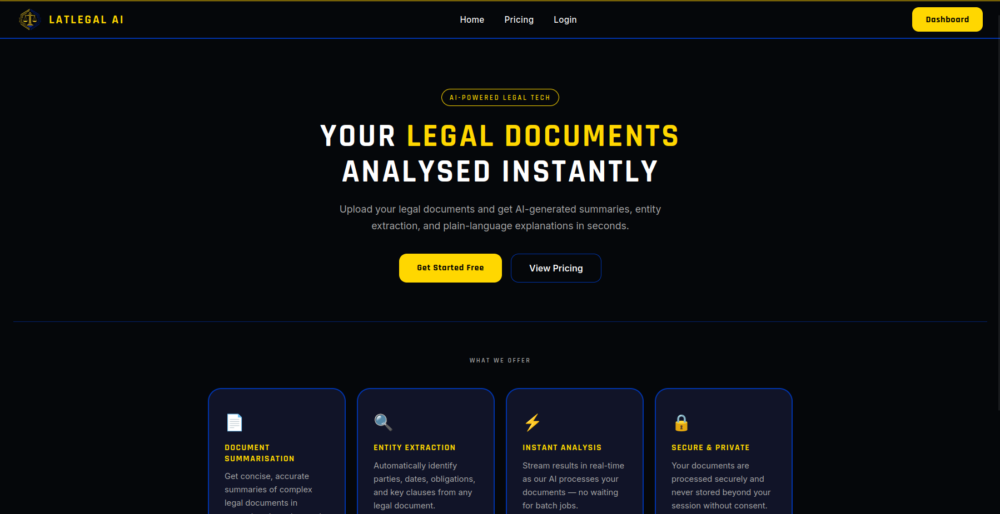

**Pricing Page**

The pricing page presents three subscription tiers: Free, Pro, and Enterprise. The Free tier includes 5 documents per month with basic summarisation and email support. The Pro tier offers unlimited documents, advanced AI analysis, entity extraction, and priority support. The Enterprise tier includes everything in Pro plus custom integrations, a dedicated account manager, and an SLA guarantee. The page uses HTMX for interactive plan selection without full page reloads.

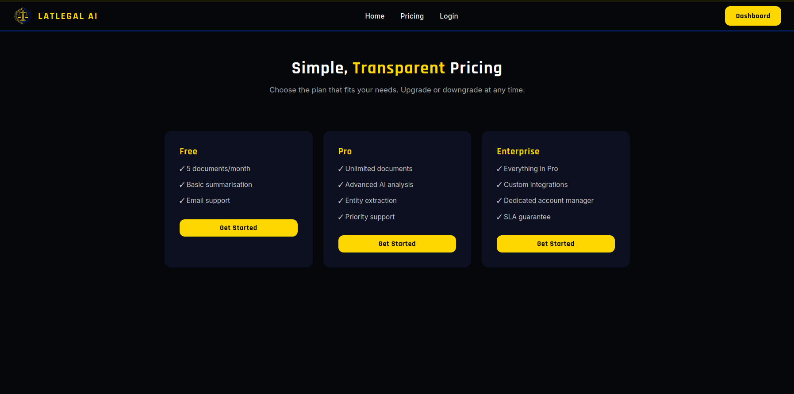

---

## Scene 2: Login and Session Configuration

**Login Screen**

The user authenticates using the Chainlit login page. The application supports password authentication for development purposes with the default admin credentials, and OAuth authentication via providers such as Google and GitHub in production. The login page uses a clean, centred card layout with the LatLegal AI branding.

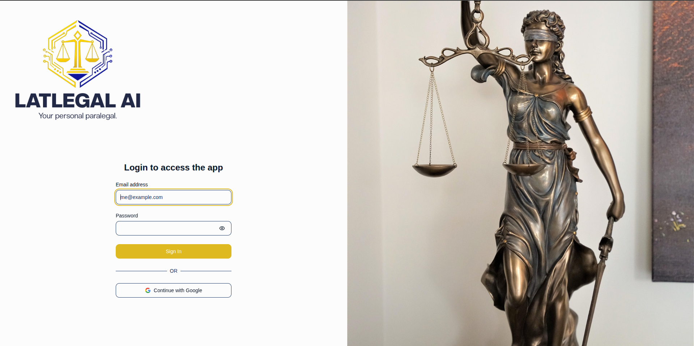

A dark theme variant of the same login screen is also available, which follows the system theme preference.

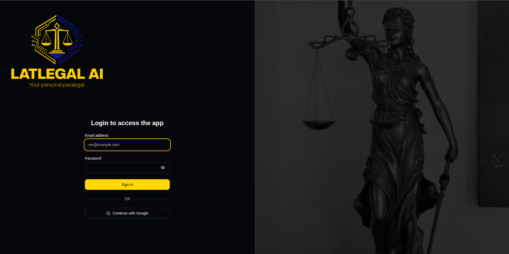

**Empty Chat Session**

After logging in, the user sees an empty chat session. The interface presents a clean conversation area with a message input at the bottom. The sidebar contains the conversation history panel, which is initially empty for a new session.

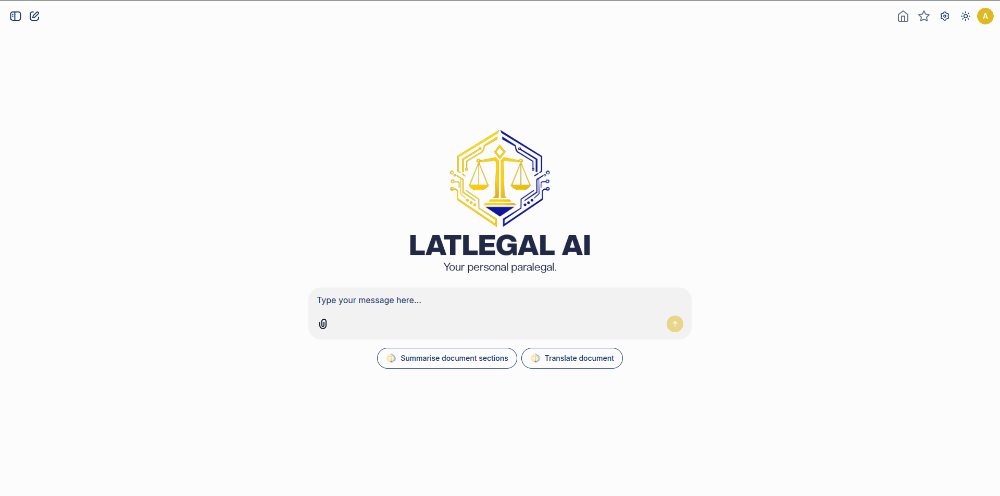

A dark theme variant is available for users who prefer a darker interface.

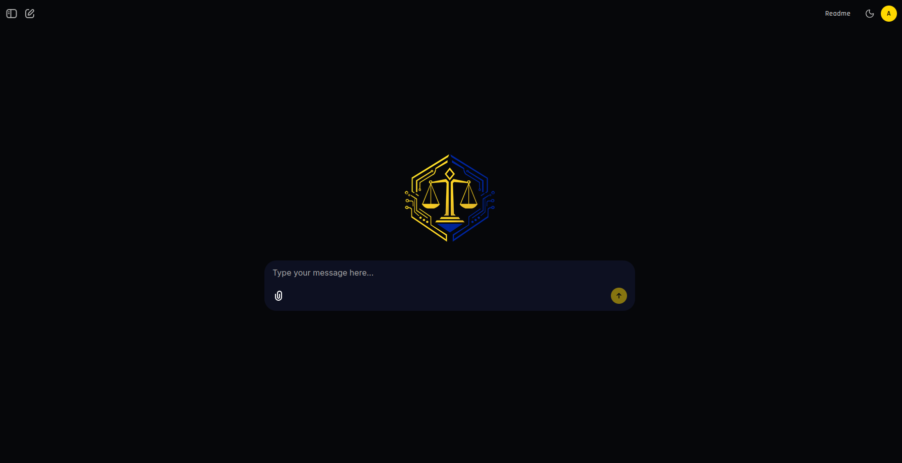

**Language Settings Configuration**

Before uploading a document, the user can configure language preferences through the settings panel in the sidebar. Two dropdown selectors are available. The OCR Language selector controls which language Tesseract uses for text recognition in scanned documents, with options including English, Hindi, French, Spanish, and German, plus an automatic detection mode. The Summary Language selector controls which language the AI uses for generating document summaries, with a wider range including English, Hindi, French, Spanish, German, Chinese Mandarin, Indonesian, Standard Arabic, Urdu, and Portuguese, plus automatic detection.

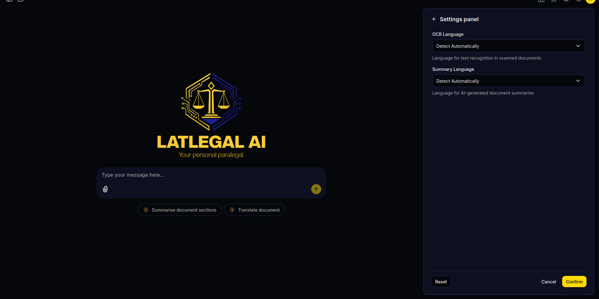

---

## Scene 3: Document Upload and Parsing

**Uploading a Document**

The user uploads a legal document by clicking the paperclip icon in the chat input area and selecting a file. The application supports PDF files including both digital and scanned documents, Word documents in docx format, and plain text files. When a file is attached, the system begins processing it immediately with visual feedback shown in the chat.

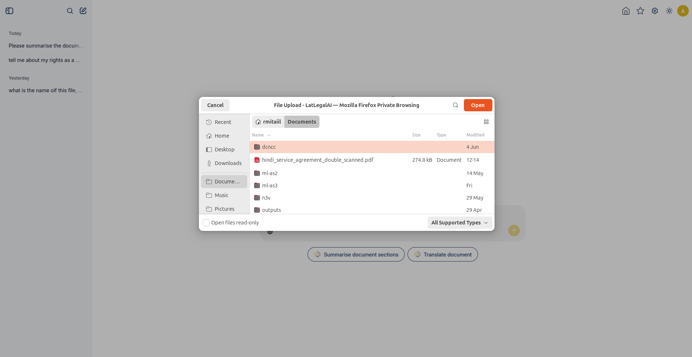

**OCR Language Detection and Document Statistics**

Once the document is parsed, the system displays the extracted text in a side panel along with document statistics. The statistics include the number of pages, the total character count, and the detected language. For scanned documents, the OCR pipeline automatically detects the document language and applies the appropriate Tesseract language pack. The extracted text is formatted in clean Markdown for readability.

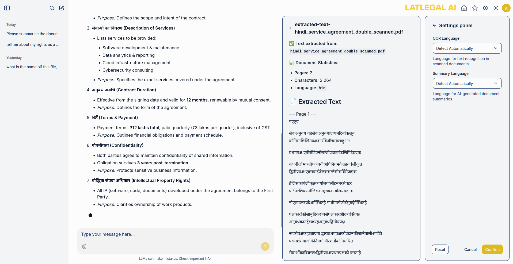

---

## Scene 4: AI Analysis

**Real-Time Streaming Analysis**

The AI analysis is streamed in real-time, allowing the user to see the response being generated as it happens. This provides immediate feedback and reduces perceived waiting time compared to batch processing. The streaming uses LiteLLM as the unified interface, which supports over 100 models across multiple providers including OpenAI, Anthropic, and OpenRouter.

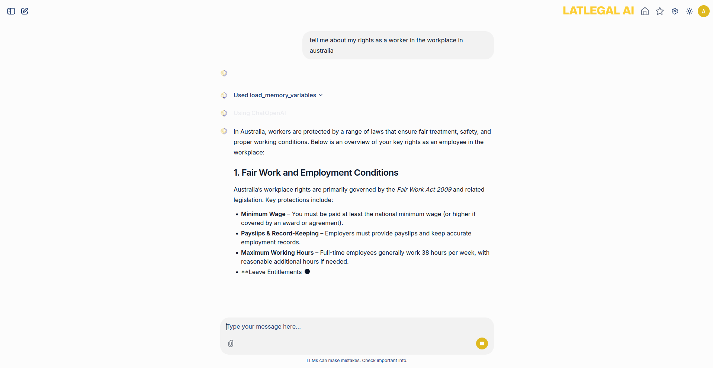

**Complete Analysis with Summary and Extracted Text**

After the streaming completes, the full analysis is displayed. The extracted text appears in a side panel on the right, accessible at any time. The AI-generated summary covers the key points of the document, identifying the document type, the parties involved, the obligations, and any important clauses. The user can refer back to the extracted text side by side with the analysis.

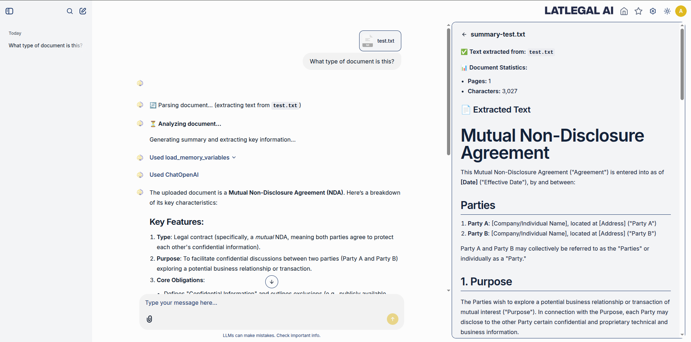

---

## Scene 5: Advanced Interaction

**Multi-Turn Conversation**

The user can continue the conversation by asking follow-up questions about the document. The AI retains context from the uploaded document and the previous conversation, allowing for natural back-and-forth interaction. For example, the user can ask about specific clauses, request clarification on legal terms, or ask for comparisons between different sections of the document.

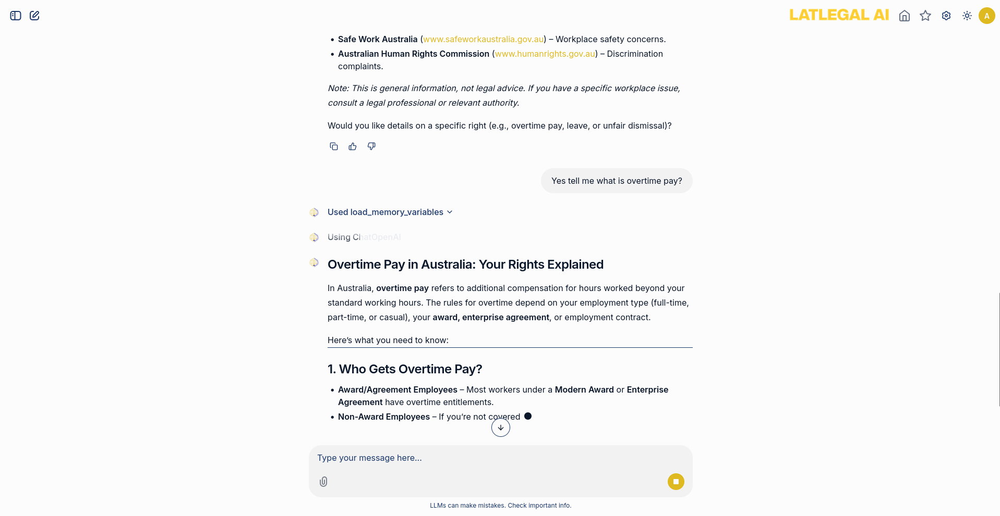

**Section Summary Analysis**

The user can request a section-by-section breakdown of the document. The AI identifies sections that are commonly associated with the detected document type and explains the purpose of each section. The analysis preserves the original section numbers and identifiers used in the source document, making it easy for the user to cross-reference with the original.

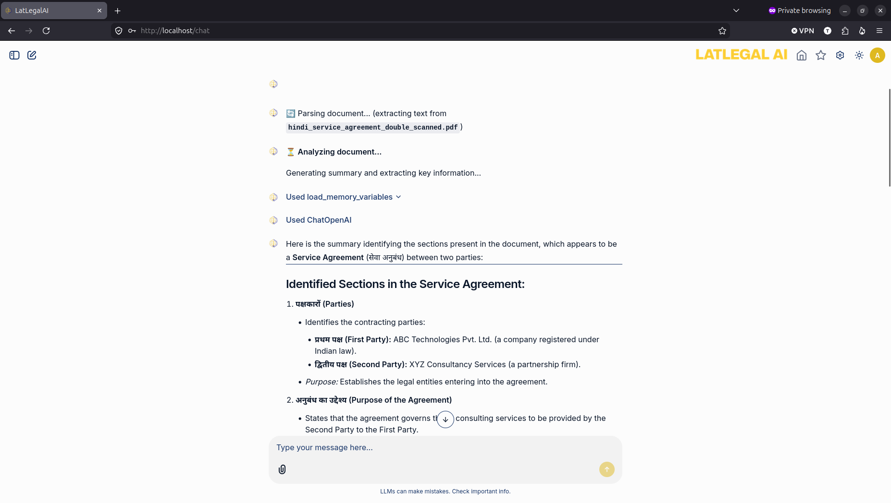

**Multilingual Summary Translation**

The application supports generating summaries in multiple languages. The user selects the target language from the Summary Language dropdown in the settings panel, and the AI generates the summary in that language. This screenshot shows a document summary generated in Mandarin Chinese for a source document in Hindi (extracted with OCR), demonstrating the multilingual capability of the platform.

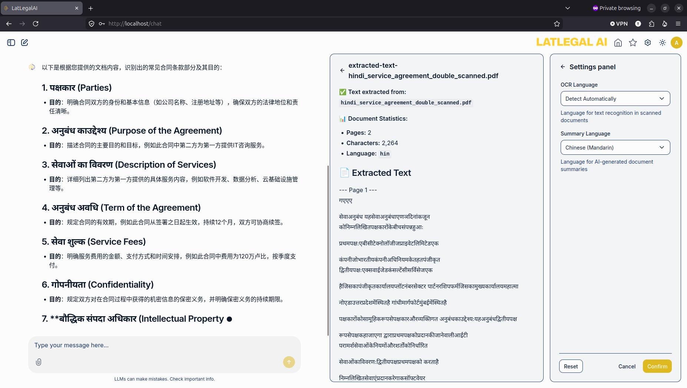

---

## Scene 6: Export and Persistence

**Download Options**

After the analysis is complete, the user is presented with download options. Two action buttons appear below the analysis. The first button allows downloading the extracted text, which is provided in both Markdown and plain text formats. The second button allows downloading the summary as a professionally formatted PDF document with the LatLegal AI branding.

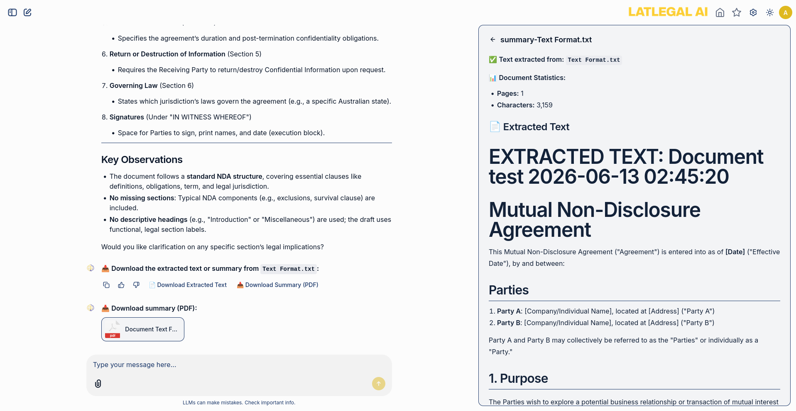

**Exported PDF Summary**

The exported PDF summary includes the LatLegal AI logo at the top, the document filename, a metadata section with the analysis timestamp and document type, the full summary text in a clean typographic layout, and a footer. The PDF is generated using WeasyPrint, which converts HTML and CSS into PDF format with reliable logo positioning and clean typography.

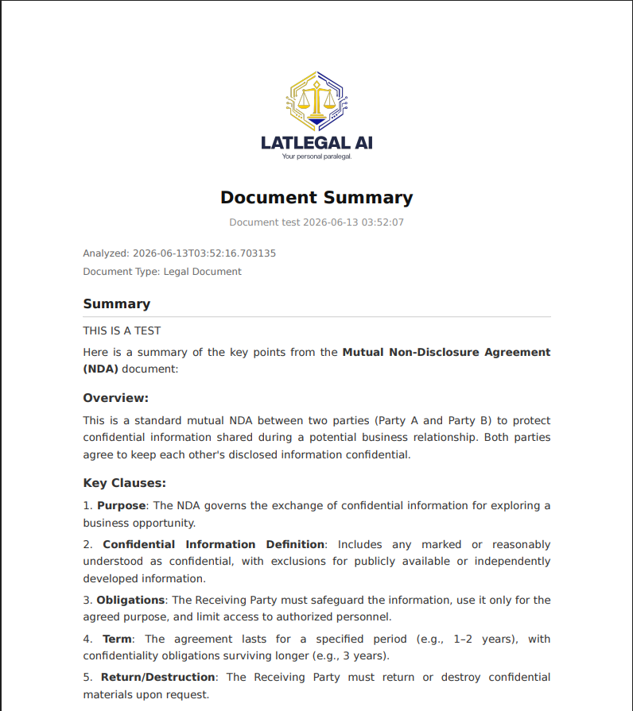

**Chat History and Thread Persistence**

All conversations are automatically saved and can be resumed later. The sidebar shows a list of previous conversation threads, each labelled with a timestamp and a preview of the first message. When the user clicks on a previous thread, the conversation is restored including the uploaded document context, the extracted text, and the AI-generated summary. This persistence is powered by the Chainlit SQLite data layer, which stores messages, elements, and thread metadata.

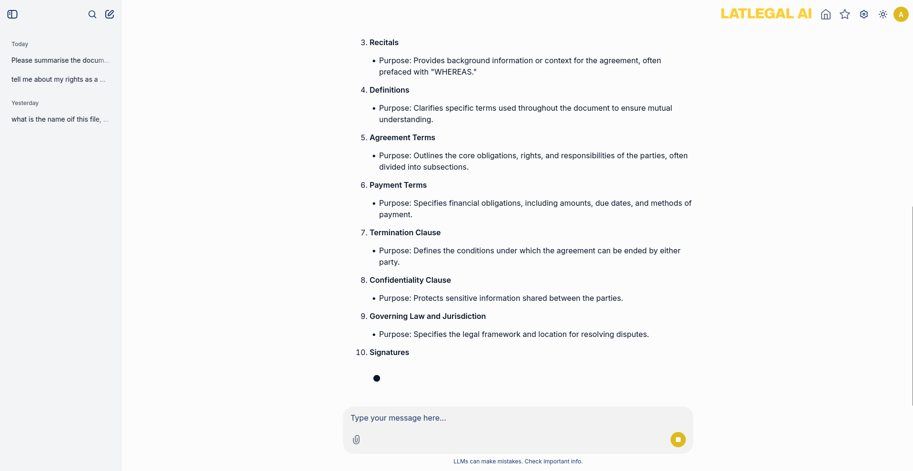

---

## Summary of Covered Features

This demonstration has shown the following capabilities of the LatLegal AI platform.

The website provides a landing page with feature descriptions and a pricing page with three subscription tiers. The Chainlit conversational interface handles authentication through password and OAuth login methods. Users can configure language settings for both OCR text recognition and AI summary generation.

The document processing pipeline supports PDF files including both digital and scanned documents, Word documents, and plain text files. Files are validated for size and format before processing. The OCR pipeline automatically detects the document language and applies appropriate Tesseract language packs. Document statistics including page count, character count, and detected language are displayed alongside the extracted text.

The AI analysis uses LiteLLM as a unified interface supporting over 100 models across multiple providers. Responses are streamed in real-time for immediate feedback. Users can engage in multi-turn conversations, request section-by-section breakdowns of documents, and generate summaries in multiple languages including Mandarin Chinese.

Export options include downloading extracted text in Markdown and plain text formats, and downloading summaries as professionally formatted PDF documents with branding. All conversations are persisted in a SQLite database and can be resumed from the chat history sidebar with full context restoration.
